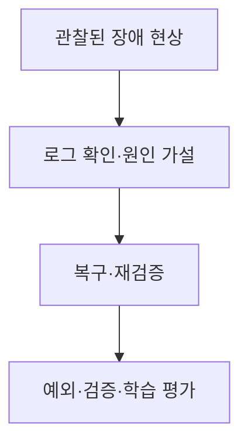

# B4-2 — 기술 학습 9요소 개요

> **PLAN_ONLY / NOT_VERIFIED.** Linux 장애 진단·복구 분야의 용어·개념·아키텍처·주요 코드 학습을 위한 준비 문서입니다. 00단계 교육 계획과 실제 코드·실습 증빙을 혼동하지 않습니다.

## 1. 용어·개념 미리보기

| 순서 | 먼저 배울 기술 용어 | 이후 확인할 내용 |
|---|---|---|
| 1 | **Symptom** | 한글·영어 정의, 역할, 필요성, 예제, 반례 |
| 2 | **Log** | 한글·영어 정의, 역할, 필요성, 예제, 반례 |
| 3 | **Process** | 한글·영어 정의, 역할, 필요성, 예제, 반례 |
| 4 | **Service** | 한글·영어 정의, 역할, 필요성, 예제, 반례 |
| 5 | **Root Cause** | 한글·영어 정의, 역할, 필요성, 예제, 반례 |
| 6 | **Recovery** | 한글·영어 정의, 역할, 필요성, 예제, 반례 |

**핵심 주제:** Linux 장애 진단·복구. 학습자는 이 기술이 왜 필요한지, 다른 기술과 무엇이 다른지 설명할 수 있어야 합니다.

## 2. 개념 아키텍처 — 교육용 Mermaid

**주의:** 개념의 관계를 보여주는 **설명용 그림**입니다. 실제 시스템 설계는 03단계, 구현은 별도 승인 이후 04단계입니다.

## 3. 9가지 기술 학습 요소

| 교육 요소 | 이번 미션에서 준비할 학습 자료 |
|---|---|
| ① 용어 | Symptom·Log·Process 등 한글/영어 정의 |
| ② 개념 | 왜 필요한지·작동 원리·선행 지식 |
| ③ 비유 | 일상 비유와 비유의 한계 |
| ④ 아키텍처 | 입력·처리·출력·실패·보안 경계 |
| ⑤ 주요 코드 | 실패코드·로그·안전한 복구 (실제 코드는 04 승인 이후) |
| ⑥ 실행 흐름 | 예측→실행→상태·출력 변화 관찰 |
| ⑦ 오류 해결 | 재현·증거·원인·수정·재검증 |
| ⑧ 실습 | PRIMM(Predict·Run·Investigate·Modify·Make) |
| ⑨ 평가 | 공식 요구·학습 목표·L1~L5·독립 수행 |

## 4. 기존 단계 연결과 검증 경계

**00:** 개념 학습 계획 → **01:** 공식 요구와 평가 매핑 → **02:** 선행 학습 분석 → **03:** 실제 설계 → **04:** 별도 승인 후 새 코드 → **05~07:** 시험·증빙·숙달 검증 → **08:** 학습 슬라이드/실습자료 → **09:** 인계.

<ins>실제 코드 개발·실행·학습자 숙달은 아직 미실시입니다.</ins> 이전 Round의 코드·PASS는 참고만 하며 신규 미션 증빙으로 사용하지 않습니다.

[중앙 학습 표준](https://github.com/MetaStudy999/codyssey-basic/blob/main/standards/LEARNER-CENTERED-AI-LEARNING-STANDARD.md) · [미션 학습계획](LEARNING-SYSTEM-PLAN.md) · [00단계 README](README.md).

## 5. 한글·영어·공식 약어와 설명·재현 확인

처음 등장한 용어는 **한글명(English Full Name, 공식 약어)** 형태로 익힙니다. 별도 약어가 없는 경우 **없음**으로 표기합니다.

| 한글명 | 영어 원명 | 공식·통용 약어 | 쉬운 뜻 |
|---|---|---|---|
| **시스템 기록** | Log | 없음 | 사건·오류의 시간별 흔적 |
| **프로세스** | Process | 없음 | 실행 중인 프로그램의 인스턴스 |
| **서비스** | Service | 없음 | 지속적으로 역할을 제공하는 프로그램·기능 |
| **근본 원인** | Root Cause | 없음 | 문제를 일으킨 바탕 원인 |

**자기 설명:** 시스템 로그(Log)는 사건과 오류의 단서를 제공합니다. 로그를 읽고 원인을 가정한 뒤 재현·확인해야 근본 원인에 가까워집니다.

**종이 재현(실행하지 않음)**
1. 서비스 오류를 알리는 가상 로그를 읽음.
2. 시간·프로세스·상태를 비교하여 가설 설정.
3. 재현 가능 여부와 복구 후 변화 점검.

**놓치기 쉬운 점:** 로그 한 줄이 반드시 유일한 근본 원인을 뜻하지는 않습니다.

**내가 이해했는지 확인:** (1) 핵심 용어의 한글·영어를 설명할 수 있는가? (2) 입력→처리→예상 결과를 자료 없이 재구성할 수 있는가? (3) 아직 실행을 검증하지 않았다는 사실을 구별할 수 있는가?

**상태:** 교육용 원리 설명·예상답만 추가했습니다. 실제 신규 코드·개발 실행·학생 L4/L5 독립 재현은 **NOT_STARTED / NOT_VERIFIED**입니다. [처음으로 돌아가기](README.md).
